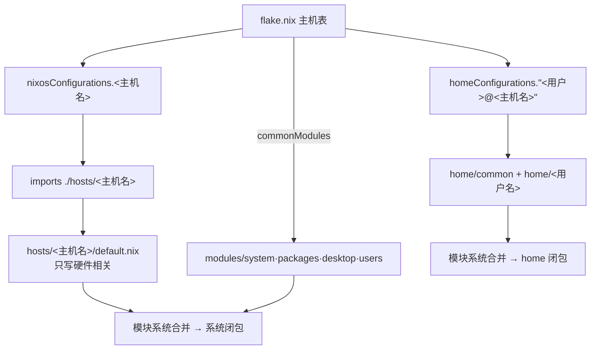

# nixos-config

个人 NixOS 配置：**flake** 统一管理，Home Manager 以**独立模式**运行。
当前系统为 `NixOS 26.05`。

| 主机      | 用户   | 桌面            | 说明                                      |
| --------- | ------ | --------------- | ----------------------------------------- |
| `XPS9560` | `jiro` | Plasma 6 + Niri | 真实在用的机器                            |
| `HHHH`    | `XXXX` | 仅 Niri         | **占位模板**，换成真实主机名/用户名后再用 |

> `HHHH` 和 `XXXX` 是占位名称。真正要改的只有两处目录名 + 一条主机表：
> `hosts/HHHH/`（主机名）、`home/XXXX/`（用户名）、`flake.nix` 的主机表。
> 主机名和用户名会由 flake 自动注入，不需要在任何 `.nix` 文件里再抄一遍。
> 具体步骤见 [新增一台主机](#新增一台主机)。

---

## 它是怎么工作的

### 1. 三层结构

```text
flake.nix          组装：主机表 → 系统配置 / 用户配置
   │
   ├── hosts/<主机名>/      「这台机器」：硬件、主机名、要哪些桌面
   └── modules/             「所有机器共享」的系统配置
   │
   └── home/common/         「所有用户共享」的用户配置
       home/<用户名>/       「这个用户」：git 身份、默认编辑器等
```

- **`modules/`** 里不放任何一台机器的私货（磁盘 UUID、主机名、用户名）。
- **`hosts/<主机名>/`** 只放与本机硬件绑定、或覆盖共享层默认值的内容。
  四个共享层（`system` / `packages` / `desktop` / `users`）由 `flake.nix` 的
  `commonModules` 统一注入，host 文件里不用再写 `../../modules/...`。
- **`home/common/`** 是两个用户共用的用户环境；**`home/<用户名>/`** 只放个人差异。

### 2. `flake.nix` 如何生成两套输出

```nix
hosts = {
  XPS9560 = { user = "jiro"; };
  HHHH    = { user = "XXXX"; };
};
```

`mapAttrs` 把它展开成：

```text
nixosConfigurations.XPS9560          # 系统：nh os switch
nixosConfigurations.HHHH
homeConfigurations."jiro@XPS9560"    # 用户：nh home switch
homeConfigurations."XXXX@HHHH"
```

求值链：



系统配置与 home 配置是**两次完全独立的模块求值**：

- `my.user` / `my.desktop` 只存在于系统侧
- `my.git` / `my.editor` 只存在于 home 侧

两边只是**约定**都用 `my.` 前缀，并不是同一个命名空间。所以不要指望 home 侧能读到 `my.user`。

### 3. `my.*` 选项是怎么传递的

`my` 不是 Nix 关键字，也没有一个地方「定义 my」。它只是普通的属性路径前缀，
真正被声明的是叶子选项。以 `my.editor` 为例：

```nix
# ① 声明：home/common/default.nix
options.my.editor = lib.mkOption {
  type = lib.types.str;
  default = "hx";
};

# ② 赋值：home/jiro/default.nix（等价于 config.my.editor = "hx"）
my.editor = "hx";

# ③ 读取：home/common/default.nix
home.sessionVariables.EDITOR = config.my.editor;
```

模块系统（`lib.evalModules`）把 `home/common` 和 `home/<用户名>` 放进同一次求值：

1. 收集所有 `options.my.editor`，注册选项和默认值
2. 收集所有 `my.editor = ...`，作为「定义」
3. 合并成最终的 `config.my.editor`
4. 其他模块读 `config.my.editor` 时拿到合并结果

几条规则：

- **必须先声明再赋值**，否则报 `The option 'my.xxx' does not exist`
- `type` 会实际检查；`type = lib.types.str` 赋数字会报错
- 两个模块给**不同的值**会冲突，并提示用 `lib.mkForce` / `lib.mkDefault`
- 不给值就用 `default`，所以只写公共默认、个别用户覆盖即可

> 一个文件里只要出现顶层 `options`，其他配置就必须放进显式 `config = { ... };`
> 或写成 `config.xxx = ...`（`home/common/default.nix` 就是这种写法）。
> 没有 `options` 的文件可以直接写 `my.xxx = ...`。

同样的机制也用在系统侧：`modules/users/default.nix` 声明 `my.user`，
`hosts/*/default.nix` 赋值；`modules/desktop/default.nix` 声明
`my.desktop.plasma.enable`，`hosts/XPS9560/default.nix` 用默认值 `true`，
`hosts/HHHH/default.nix` 显式设为 `false`。

### 4. 主机名是怎么确定的

**没有运行时自动分发**。host 是「构建/切换那一刻」由命令选中的：

- `nh os switch` 默认用当前 `hostname` 去匹配 `nixosConfigurations.<主机名>`
- 也可以显式指定：`nh os switch -H HHHH` 或 `sudo nixos-rebuild switch --flake .#HHHH`
- 选中后，`specialArgs.hostName` 传进 `hosts/<主机名>/default.nix`，
  最终写入 `networking.hostName`。所以**主机名既是选择依据，也是配置结果**。
- 开机时不再选择：每个代际都是某个具体主机的完整闭包。

`nh home switch` 类似，默认尝试 `<当前用户>@<当前主机名>`，
也可用 `-c XXXX@HHHH` 显式指定。

首次安装时 Live ISO 的 hostname 通常是 `nixos`，匹配不到任何配置，
所以**必须显式指定** `.#HHHH`。

---

## 目录结构

```text
.
├── flake.nix                     # 入口：inputs、pkgs、主机表、两套配置
├── flake.lock                    # 锁定所有输入的确切版本
├── overlays/
│   └── unstable.nix              # unstable 包名单 + overlay（唯一维护点）
├── hosts/
│   ├── XPS9560/
│   │   ├── default.nix           # 本机入口：只 import 硬件文件 + 覆盖项
│   │   ├── hardware-configuration.nix  # 安装器生成：磁盘/内核模块，勿手改
│   │   ├── disks.nix             # 本机 btrfs 挂载参数（哪些挂载点要 noatime/压缩）
│   │   ├── external-disks.nix    # 额外分区（NTFS 数据盘 /mnt/data）
│   │   └── gpu.nix               # 双显卡：核显 + NVIDIA（PRIME offload）
│   └── HHHH/                     # 占位主机（纯 Niri 的最小模板）
│       ├── default.nix           # my.desktop.plasma.enable = false + 核显/固件
│       └── hardware-configuration.nix  # 占位存根（含假挂载点），安装时覆盖
├── modules/                      # 与机器无关的系统配置（由 flake 的 commonModules 注入）
│   ├── system/
│   │   ├── default.nix           # system 层汇总入口
│   │   ├── nix.nix               # flakes、二进制缓存、nh
│   │   ├── base.nix              # PipeWire、蓝牙、网络、fwupd、journald、nix-ld
│   │   ├── boot.nix              # systemd-boot
│   │   ├── btrfs.nix             # scrub、fstrim、snapper、.snapshots 子卷（按挂载点自动生效）
│   │   └── locale.nix            # 时区、语言、终端/GUI 的消息语言策略
│   ├── desktop/
│   │   ├── default.nix           # desktop 层入口 + 登录器（lemurs）
│   │   ├── plasma.nix            # Plasma 6（受 my.desktop.plasma.enable 控制）
│   │   ├── niri.nix              # Niri（平铺合成器），与 Plasma 并列可选
│   │   ├── fonts.nix             # 字体与 fontconfig 默认字体
│   │   └── input-method.nix      # fcitx5 + Rime 雾凇拼音
│   ├── packages/
│   │   └── default.nix           # 系统级包：命令行工具 + 大件桌面应用
│   └── users/
│       └── default.nix           # 主用户（用户名由每台主机指定）
└── home/
    ├── common/                   # 所有用户共用
    │   ├── default.nix           # 入口：home.packages、备份策略、my.editor / my.repoDir 声明
    │   ├── shell.nix             # fish/bash、starship、kitty、eza、代理函数
    │   ├── yazi.nix              # yazi 文件管理器（插件、键位、预览）
    │   ├── git-ssh.nix           # my.git 声明、GitHub SSH 配置
    │   ├── neovim.nix            # Neovim
    │   ├── helix.nix             # Helix（unstable）
    │   ├── niri.nix              # niri 配置（生成 base.kdl + 挂 dotfiles 里的 config.kdl）
    │   ├── noctalia.nix          # Noctalia 外壳（unstable）+ 挂 dotfiles 里的配置
    │   ├── zed-editor.nix        # Zed（unstable）与语言服务器
    │   ├── btop.nix              # btop 的 GPU 监控配置（本体在系统侧）
    │   ├── mime.nix              # 默认应用（my.fileManager）与 MIME 关联
    │   └── rime.nix              # Rime 的 default.custom.yaml（候选数、Shift 行为）
    ├── jiro/                     # jiro 的个人模块目录
    │   └── default.nix           # my.git、my.editor；可继续拆多个文件
    └── XXXX/                     # 占位用户的个人模块目录
        └── default.nix           # my.git、my.editor

dotfiles/                         # 自己手改的用户配置（不走 Nix 生成）
├── niri/
│   └── config.kdl                # ← 日常改这里；保存即热重载，不用 rebuild
└── noctalia/
    └── 00-nix.toml               # Noctalia 基础配置（保存即热重载）
```

**命名约定（必须一致）**：

| 名字   | 权威定义（Only one place）                            | 自动到达的地方                                                                |
| ------ | ----------------------------------------------------- | ----------------------------------------------------------------------------- |
| 主机名 | `flake.nix` 主机表的键 + `hosts/<主机名>/` 目录名     | `specialArgs.hostName` → `networking.hostName`、`nixosConfigurations.<名>`    |
| 用户名 | `flake.nix` 主机表的 `user` + `home/<用户名>/` 目录名 | `specialArgs.userName` → `my.user.name`、`homeConfigurations."<用户>@<主机>"` |

> **主机名和用户名都不要写在任何 `.nix` 文件里**。host 文件里只写
> `networking.hostName = hostName;` 和 `my.user.name = userName;`，
> 自己就把主机表里的值传进选项系统。

---

## 组成概览

| 项目     | 选择                                                                                            |
| -------- | ----------------------------------------------------------------------------------------------- |
| 引导     | systemd-boot（EFI，保留 15 个旧代）                                                             |
| 文件系统 | btrfs（`@` `/home` `/nix` `/var/log` `/var/cache` `@snapshots`）+ 独立 swap 分区 + vfat `/boot` |
| 快照     | snapper（`/` 与 `/home`，每日 7、每周 4）+ btrfs 自动 scrub                                     |
| 桌面     | KDE Plasma 6；Niri + Noctalia（unstable）。登录界面 lemurs 可选会话                             |
| 声音     | PipeWire（含 ALSA/PulseAudio 兼容）                                                             |
| 显卡     | Intel HD 630 核显 + NVIDIA GTX 1050M，PRIME offload（`nvidia-offload` 按需调用独显）            |
| 网络     | NetworkManager                                                                                  |
| 输入法   | fcitx5 + Rime 雾凇拼音（`rime-ice`）                                                            |
| 字体     | Maple Mono NF CN、霞鹜文楷/新月黑、Noto CJK、Inter、Libertinus                                  |
| Shell    | fish（主力）+ bash（兼容）+ starship + kitty                                                    |
| 文件管理 | yazi（TUI，fish 函数 `y` 退出后自动 cd；git 状态、压缩包预览、smart-enter）                     |
| 编辑器   | Neovim、Helix、Zed（后两者取 unstable）                                                         |
| 排版     | Typst + Tinymist                                                                                |
| Nix 缓存 | 中科大 / 清华 / 南京大学 / 上海交大（末位）镜像，官方 `cache.nixos.org` 自动兜底                |

> 上表描述的是 XPS9560。`HHHH` 是精简模板：没有 NVIDIA，默认只装 Niri。

---

## 日常使用

### 前提

`nh` 已经直接指向仓库路径（`modules/system/nix.nix` 里的 `programs.nh.flake`），
不再依赖 `/etc/nixos` 软链。下面这条只是习惯做法，方便其他工具去 `/etc/nixos`
找配置，可选（路径按实际用户名替换）：

```bash
sudo rm -rf /etc/nixos
sudo ln -s /home/jiro/nixos-config /etc/nixos
```

### 应用改动

```bash
# 只改了 home/common/ 或 home/<用户名>/ 下的内容（不需要 sudo）
nh home switch

# 改了 hosts/、modules/、flake.nix（需要 sudo）
nh os switch

# 只构建、不切换（检查是否编译通过）
nh os build
```

`nh os switch` 会按当前主机名自动选配置；不是当前主机、或主机名还没生效时用 `-H`：

```bash
sudo nh os switch -H HHHH
```

等价的原始命令：

```bash
# XPS9560
home-manager switch --flake .#jiro@XPS9560
sudo nixos-rebuild switch --flake .#XPS9560

# HHHH
home-manager switch --flake .#XXXX@HHHH
sudo nixos-rebuild switch --flake .#HHHH
```

### 新增一台主机

以现在的 `HHHH` / `XXXX` 占位为例，**只需改目录名 + 主机表**：

1. **目录**（目录名就是主机名 / 用户名）
   ```bash
   git mv hosts/HHHH hosts/<真实主机名>
   git mv home/XXXX home/<真实用户名>
   ```
2. **`flake.nix` 主机表**
   ```nix
   <真实主机名> = { user = "<真实用户名>"; };
   ```
   改完这两处，`networking.hostName`、`my.user.name`、
   `nixosConfigurations.<主机名>`、`homeConfigurations."<用户>@<主机>"` 全部自动对齐。
3. **`hosts/<真实主机名>/default.nix`**：只确认硬件/桌面开关，不用写用户名
   ```nix
   my.desktop.plasma.enable = false;    # 要 KDE 就删掉这行或设为 true
   ```
4. **`home/<真实用户名>/default.nix`**：填个人身份
   ```nix
   my.git = {
     userName = "<真实用户名>";
     userEmail = "<真实 GitHub 邮箱>";
   };
   my.editor = "hx"; # 或 "nvim"
   ```

如果只是加一台全新机器，复制 `hosts/HHHH`（最小模板）比复制 XPS9560 更干净，
不会带进 NVIDIA 和 NTFS 挂载。

如果只是加一台全新机器，复制 `hosts/HHHH`（最小模板）比复制 XPS9560 更干净，
不会带进 NVIDIA 和 NTFS 挂载。

### 首次安装（占位主机）

1. 安装 NixOS，勾选 flakes（或安装后启用 `nix-command` / `flakes`）
2. 把仓库克隆到该用户家目录：`/home/<用户名>/nixos-config`
   （`programs.nh.flake` 和 README 的路径都按这个约定）
3. **生成真实硬件配置**（会覆盖占位挂载点）：
   ```bash
   sudo nixos-generate-config --dir hosts/<主机名>
   ```
4. 按实际硬件检查 `hosts/<主机名>/default.nix`：
   - Legacy/BIOS 启动：取消 GRUB 那段注释，并关掉 systemd-boot
   - 核显驱动：Gen7 用 `intel-vaapi-driver`，Gen8+ 用 `intel-media-driver`
5. 首次切换（Live ISO 的 hostname 是 `nixos`，必须显式指定）：
   ```bash
   sudo nixos-rebuild switch --flake .#<主机名>
   ```
6. 之后 hostname 生效，直接 `sudo nh os switch` 即可
7. 首次登录后设置密码：`passwd`（配置里没有声明初始密码）

### 更新依赖

```bash
nix flake update                      # 更新全部输入
nix flake update nixpkgs-unstable     # 只更新 unstable 源
```

`nix flake update` 只改 `flake.lock`，还需要再 `nh os switch` / `nh home switch`
才会应用。

### 格式化

```bash
nix fmt        # 使用 nixfmt 格式化仓库内所有 .nix
```

### 回滚

```bash
sudo nixos-rebuild switch --rollback
home-manager switch --rollback
```

系统层面也可以在开机菜单里选择旧代（保留 15 个）。

### 清理

`modules/system/nix.nix` 已启用 `nh clean`：每周自动清理，保留 30 天内最多 15 代。
手动清理：

```bash
nh clean all
```

---

## unstable 包管理

名单集中在 `overlays/unstable.nix`：

```nix
names = [
  # "google-chrome"
  "zed-editor"
  "helix"
  "noctalia" # Niri 的桌面外壳（unstable 更新更快）
];
```

- **新增**：把包名（nixpkgs 里的顶层属性名）加进 `names`，安装处继续写 `pkgs.xxx`
- **移除**：删掉对应那行
- **整体关闭**：注释掉 `flake.nix` 中 `overlays` 列表里的 `(import ./overlays/unstable.nix { ... })`，
  系统立即回到纯 stable，安装文件一行都不用改
- **注意**：overlay 用的是 `nixpkgs-unstable.legacyPackages`（省一次 nixpkgs 求值），
  它没有 `allowUnfree`。如果以后把 `google-chrome` 这类非自由包加进 `names`，
  需要把 `overlays/unstable.nix` 改回 `import nixpkgs-unstable { inherit system config; }`

---

## 桌面（Plasma + Niri / 纯 Niri）

- **XPS9560**：登录时列出 `Plasma (Wayland)`、`Plasma (X11)` 和 `Niri`；`HHHH` 关掉 Plasma，只留 `Niri`
- **开关**：`modules/desktop/default.nix` 里的 `my.desktop.plasma.enable`（默认 `true`），
  `hosts/HHHH/default.nix` 里设为 `false`
- **登录管理器**：`lemurs`（纯文本 TUI，跑在 tty1，不需要合成器），
  定义在 `modules/desktop/default.nix`，与桌面环境无关，两台机器共用
  - 配置只有三项：`username_field.remember`、`environment_switcher.remember`
    （这两项本来就是 lemurs 默认值，写出来是为了让行为「看得见」），
    以及 `environment_switcher.max_display_length = 16`
    （默认只有 8，会把 `Plasma (Wayland)` 截成 `Plasma (`）
  - 会话列表由模块自动指向 `.../desktops/share/{wayland-sessions,xsessions}`
- **默认上次的会话**：lemurs 记住「上次登录的用户名 + 上次选的桌面环境」，
  缓存在 `/var/cache/lemurs`，重启后仍然有效；在登录界面里换会话会覆盖它
- **⚠️ Wayland 会话需要 `seat` 组**：lemurs 用 `setLoginUid = false` 启会话
  （上游 #166），niri 取显卡/输入设备走 `seatd`。所以主用户的默认组里加了 `seat`
  （`modules/users/default.nix`），模块会自动启 `services.seatd`
- **⚠️ 两个必须的补丁（lemurs 0.4.0 的坑，都在 `modules/desktop/default.nix`）**：
  1. **X11 键鼠全无**：lemurs 默认直接 exec 裸的 `X`，不带 NixOS 生成的
     `-config .../xserver.conf`（`ModulePath` 在那里），于是报
     `(EE) Failed to load module "libinput"`。所以 `x11.xserver_path` 换成了
     一个 wrapper，把 `services.xserver.displayManager.xserverArgs` 带上
     （并去掉 `-terminate`，否则 `xrdb` 这类一次性客户端会把 X 关掉）。
     等价修法：nixpkgs PR #568385
  2. **Plasma (Wayland) 输入密码后被弹回登录界面**：lemurs 在**主进程**里调
     `pam_open_session`，而且开会话前会把 `XDG_SEAT` / `XDG_VTNR` 从自己环境里删掉，
     `pam_systemd` 算不出 VT，会话变成 `Seat=` 空、`VTNr=0`。KWin **不用 libseat**，
     只靠 logind 的 `TakeDevice`，于是报
     `kwin_wayland: No suitable DRM devices have been found`，
     整套 Plasma 的 Qt 进程（ksplashqml/plasmashell/kded…）跟着 abort。
     修法：在 `lemurs` 的 PAM session 栈里插一个 `pam_env`（order 取
     `systemd.order - 1`，避开已占用的 11900），把 `XDG_SEAT=seat0` /
     `XDG_VTNR=1` 写进 **PAM 环境**。
     写进 systemd 服务环境没用（lemurs 会把它删掉，实测无效）。
     上游 commit `7283f01` 尚未发布（见上游 issue #256 / #249）
  - 验证：登录后 `loginctl show-session $XDG_SESSION_ID -p Seat -p TTY`
    应该看到 `Seat=seat0; vc1`、`TTY=tty1`
- **排查**：`/var/log/lemurs.log`（主流程）、`/var/log/lemurs.client.log`（会话输出）
- **外观**（lemurs 是纯文本 TUI，所以「字号」不归它管）：
  - **字号 = 控制台字体**：`console.font = "ter-128n"` +
    `console.packages = [ pkgs.terminus_font ]`（1080p 下 137 列 × 38 行；
    想更大用 `ter-132n`，小一点用 `ter-124n`）。对所有 tty 生效，包括 Ctrl+Alt+F2
  - 登录表单在屏幕上方而非居中：这是 lemurs 0.4.0 写死的布局
    （`src/ui/chunks.rs`），上游也没有配置项。曾经用一个小 patch 居中，
    但为了避免 nixpkgs 升级时构建失败，已经去掉（保持原版上游代码）
- **系统侧 / 用户侧分工**：`modules/desktop/niri.nix` 负责装 niri、注册会话、
  配 X11 兼容与 noctalia 需要的服务；`home/common/niri.nix` 负责 `config.kdl` 与 noctalia
- **配置分两层**：
  - `~/.config/niri/base.kdl`：构建时由 niri 自带 `default-config.kdl` 生成
    （去掉默认的 waybar spawn，alacritty → kitty），在 store 里，随 niri 升级自动更新
  - `~/.config/niri/config.kdl`：软链到仓库里的 `dotfiles/niri/config.kdl`
    （out-of-store 软链），日常编辑这个
- **热重载（不用 rebuild）**：改 `dotfiles/niri/config.kdl` 保存即可，
  niri 会立刻热重载，**不需要 `nh home switch`**。若编辑器用原子保存导致没反应，
  执行 `niri msg action load-config-file`
- **什么时候才需要 rebuild**：改了 `home/common/niri.nix` 里的生成规则，或增删软件包
- **X11 程序**：niri 25.08 起自带 `xwayland-satellite` 集成，只要
  `environment.systemPackages` 里有 `xwayland-satellite`，有 X11 客户端连接时
  niri 会自动拉起它（也会自动重启），不用写 `spawn-at-startup`
- **输入法**：fcitx5 走 Wayland `text-input` 协议；niri 模块已开启 xdg-autostart，
  所以 fcitx5 会随会话自启

## Noctalia 的设置怎么管

配置文件分两层（官方文档 + 5.3.0 实测）：

| 优先级 | 路径                                              | 谁来写                  |
| ------ | ------------------------------------------------- | ----------------------- |
| 低     | `~/.config/noctalia/*.toml`（按文件名字母序合并） | 我们（软链到 dotfiles） |
| 高     | `~/.local/state/noctalia/settings.toml`           | noctalia 设置界面       |

- **两个目录都被监听，保存即热重载**，不用执行命令也不用 rebuild
  （`noctalia msg config-reload` 只是手动兜底）
- **`~/.config/noctalia/` 下的文件永远不会被 noctalia 重写**，包括版本升级迁移。
  迁移只升 `settings.toml`；配置目录里的旧键只在读取时临时规范化，
  并在通知里指出「文件:行:键」让你自己改。⇒ 软链和文件名都是稳定的
- **想写死的项**：写进 `dotfiles/noctalia/00-nix.toml`（文件名前缀决定覆盖顺序，越大越靠后）
- **用界面调**：改动会写进 `settings.toml`，并且**压过**上面文件里的同名键。
  想让配置文件的值得胜，就把 `settings.toml` 里对应键删掉
- **查可用键**：`noctalia config export full`（含内置默认值，约 750 行）
- **校验**：`noctalia config validate`（按真实加载顺序，含 `settings.toml`）
- **备份当前界面设置**：`noctalia config export merged > dotfiles/noctalia/settings-export.toml`
  （恢复：拷回 `~/.local/state/noctalia/settings.toml`；如果是软链，noctalia 会写入链接目标并保留链接）

## 双显卡（Intel 核显 + NVIDIA 独显，仅 XPS9560）

配置在 `hosts/XPS9560/gpu.nix`（Optimus 笔记本，PRIME render offload）。
`HHHH` 作为纯 Intel 模板，不 import 这个文件，只开 `hardware.graphics.enable` +
`intel-vaapi-driver`（HD 4000 是 Gen7，用 i965 驱动；实际硬件不同要相应调整）。

- **平时全部跑核显**，独显空闲（省电、发热低、续航正常）
- **需要独显时**用 `nvidia-offload` 启动单个程序：

  ```bash
  nvidia-offload glxinfo | grep "OpenGL renderer"   # 确认真的用的是独显
  nvidia-offload steam
  nvidia-smi                                        # 查看两张卡状态
  ```

  `glxinfo` 由系统侧的 `mesa-demos` 提供；`nvidia-offload` 本身只是设置
  `__NV_PRIME_RENDER_OFFLOAD` 等变量后 `exec` 传入的命令，所以命令必须在 `PATH` 里。

- **驱动分支必须是 `legacy_580`**：nixpkgs 的 `stable` 已是 595 系列，
  而 NVIDIA 从 580 之后不再支持 Pascal（GTX 10xx）。升级 nixpkgs 时不要把它改回默认。
- **不要开 `hardware.nvidia.powerManagement`**：动态断电只支持 Turing 及以后，Pascal 上开了会出问题。
- 第一次从 nouveau 切到 nvidia 后**需要重启**。

## 输入法（Rime 雾凇拼音）

`home/common/rime.nix` 生成 `default.custom.yaml`：

- 候选词数量：7
- `Shift_L` = `commit_code`：把已输入的拼音原样上屏为英文，并切到英文
- `Shift_R` = `inline_ascii`：进入临时西文模式，空格/回车确认后回到中文
- 文件内容变化时自动删除 `~/.local/share/fcitx5/rime/build/default.yaml`，
  让 Rime 重新编译配置（Rime 只按 mtime 判断配置是否更新）

如果升级 nixpkgs 改动了 `rime-ice` 词库或方案，需要手动清一次完整缓存：

```bash
rm -rf ~/.local/share/fcitx5/rime/build
```

## 用户环境

- **Shell**：fish + starship；kitty 作为终端，字体 `Maple Mono NF CN`
- **yazi**：终端文件管理器，配置在 `home/common/yazi.nix`

  ```bash
  y          # 进入 yazi（fish 函数），退出后 shell 会停在最后浏览的目录
  ```

  - 键位沿用 yazi 默认（h/j/k/l、空格选中、y/x 复制剪切、d 删除、a 新建、r 重命名），
    只额外加了：`Enter` 智能打开、`C` 压缩、`M` 改权限
  - 预览依赖由 nixpkgs 的 yazi 自带（fd / rg / fzf / zoxide / ffmpeg / poppler /
    chafa / resvg / 7zz），另外补了 `ouch`（压缩包预览）、`git`（状态标记）、
    `wl-clipboard`（系统剪贴板）
  - **yazi 没有配置热重载**：改 `yazi.nix` 需要 `nh home switch`，然后重开 yazi 才生效

- **btop**：本体由系统侧的 `security.wrappers.btop` 提供（带 `CAP_PERFMON`），
  所以不用 sudo 就能看 Intel 核显；构建时 `cudaSupport = true` 只是给二进制加
  `/run/opengl-driver/lib` 的 RUNPATH，让 NVML 能找到 `libnvidia-ml.so.1`（独显）。
  GPU 面板默认不显示，需要时在 btop 里按 `5` / `6` 打开（`shown_boxes` 里写死
  GPU 面板会在显卡数量不匹配时让整个布局失效，所以交给运行时）；
  `shown_gpus = "nvidia intel"` 只探测实际存在的厂商。
  配置文件由 `home/common/btop.nix` 生成，是只读软链，
  所以在 btop 界面里改设置不会持久化，请改 Nix 配置
- **eza**：`eza` 别名带 `--icons auto` 和 `--git`；HM 生成的 `ls`/`ll`/`la` 默认不带图标，
  需要的话可用 `home.shellAliases` 覆盖（图标需要 Nerd Font）
- **fzf / zoxide**：fish 与 bash 都启用了 shell 集成：
  `Ctrl-R` 历史、`Ctrl-T` 文件、`Alt-C` 目录；`z <关键字>` 跳目录、`zi` 交互式选择。
  这些是 shell 里直接可用的，和 yazi 内部自带的 fzf/zoxide 是两套（互不影响）
- **代理**：**默认不导出任何代理变量**。需要时在 fish / bash 里执行 `proxy_on`
  （导出 `127.0.0.1:7890`，flclash），用完 `proxy_off`。这样 flclash 没启动时，
  `git` / `curl` 不会去连一个不存在的代理；两种 shell 的函数定义都在 `shell.nix`，
  变量只在函数体里写一份
- **Git / SSH**：提交身份在 `home/<用户名>/default.nix`（`my.git.userName` / `my.git.userEmail`），
  不写在 `flake.nix` 里；`~/.ssh/id_ed25519` 对应 GitHub，`programs.ssh` 中已配置
  `github.com` 的 Host / IdentityFile / 连接复用
- **编辑器**：终端默认编辑器由 `my.editor` 控制（jiro 用 `hx`，占位用户示例用 `nvim`），
  同时写入 `EDITOR` / `VISUAL` / `SUDO_EDITOR`；Zed 使用 nixd + nixfmt、
  rust-analyzer、pyright + ruff、tinymist
- **仓库路径**：`my.repoDir`（`home/common/default.nix`，默认 `~/nixos-config`）。
  `dotfiles/` 里的文件通过 out-of-store 软链挂进 `~/.config`，用的就是这个路径。
  仓库改名/换目录名时只改这里一处即可（系统侧的 `programs.nh.flake` 同理，
  在 `modules/system/nix.nix`）
- **开发 / 排版工具**：`gnumake`、`nixd`/`nixfmt`、`rust-analyzer`/`rustfmt`、
  `pyright`/`ruff`、`typst`/`tinymist` 放在系统侧（`modules/packages/default.nix`），
  让 home 闭包更小（实测 884 → 831 个 store 路径）；对冷启动时间的改善很小，
  主要是精简 profile。升级它们需要 `sudo nh os switch`

## 注意事项

1. **`hardware-configuration.nix` 不要手改**。XPS9560 的是安装器生成的真实文件；
   `HHHH` 里的是占位存根（含假挂载点），首次安装前必须用
   `nixos-generate-config --dir hosts/HHHH` 覆盖。
2. **新增 `.nix` 文件后必须 `git add`**，否则 flake 运行时看不到它（flake 只读取
   已跟踪的文件），会报 `No such file or directory`。
3. `nix build` 生成的 `result` 软链已被 `.gitignore` 忽略，不要 `git add`。
4. **没有声明初始密码**。首次安装后需要进 TTY 用 `passwd` 设一次；
   要声明式管理就换成 `hashedPasswordFile`，哈希文件放在仓库之外（如 `/run/secrets/<用户名>-password`）。
5. 本仓库不含任何私钥或 API Key；Zed 的模型接口只写了地址，密钥需在编辑器内自行填写。
6. 所有磁盘 UUID 都与本机绑定，迁移到其他机器时需要重新生成
   `hardware-configuration.nix` 并检查 `disks.nix` / `external-disks.nix`。
7. 快照与子卷均在 `modules/system/btrfs.nix` 里，自动按挂载点判断：
   只有存在 `/.snapshots` 才配根快照，只有 `/home` 是独立挂载才
   配 home 快照并开机补 `/home/.snapshots` 子卷（`create-home-snapshots-subvolume`）。
   想让新机器也有 home 快照，就在它的 `hardware-configuration.nix` 里
   把 `/home` 做成独立子卷并挂载（参考 XPS9560）。
8. `hosts/<主机名>/` 与 `home/<用户名>/` 的目录名必须和 `flake.nix` 主机表一致，
   否则会报 `path does not exist`。反过来，**任何 `.nix` 文件里都不应该再硬编码主机名/用户名**。

## License

[MIT](./LICENSE)
