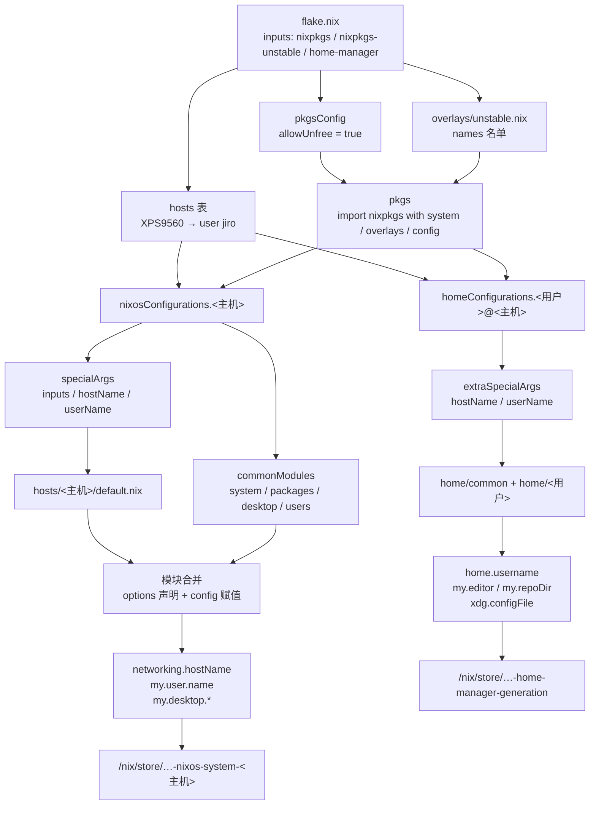
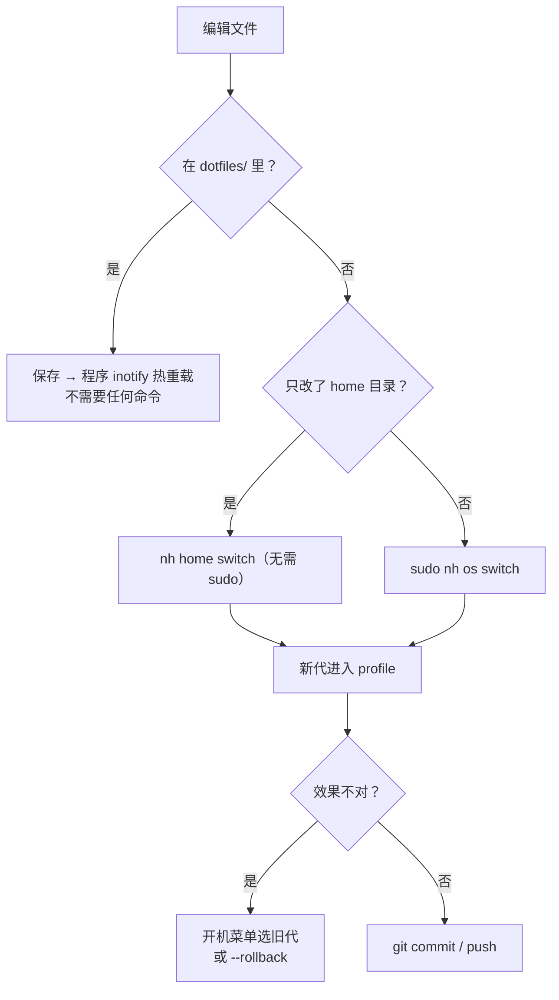
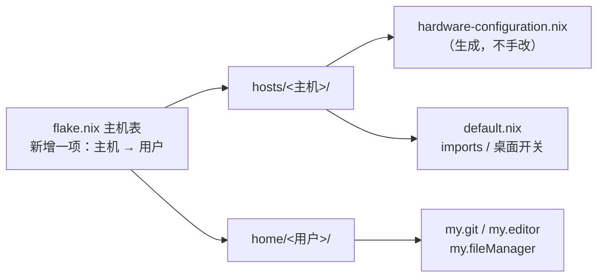
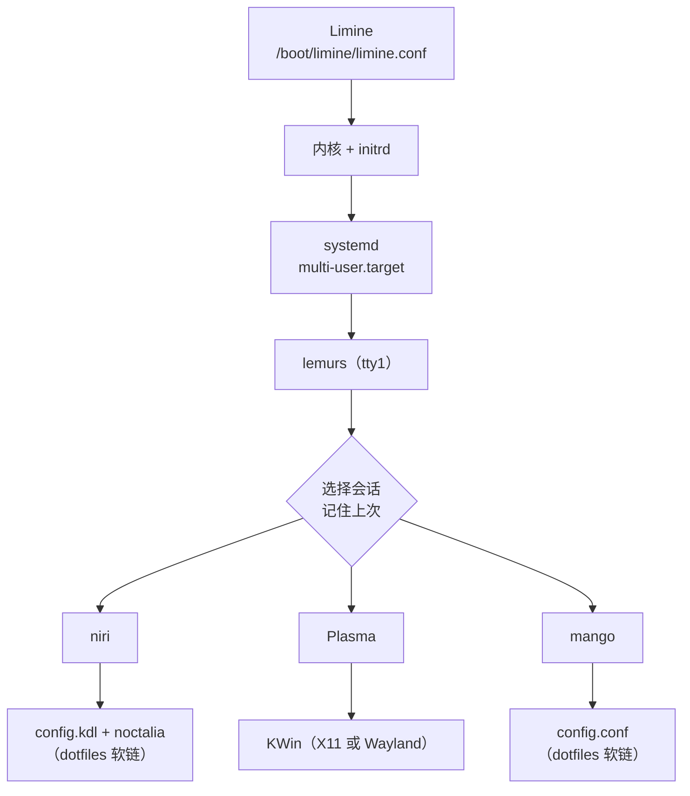

# 使用手册

一台机器的系统配置和一个人的桌面环境是这个仓库的两条主线。看懂「架构」一节，
其余都是操作步骤。

## 架构

### 三层

| 层       | 位置                     | 放什么                                             | 生效命令                                  |
| -------- | ------------------------ | -------------------------------------------------- | ----------------------------------------- |
| 装配     | `flake.nix`、`overlays/` | inputs、主机表、共用 `pkgs`、unstable 名单         | `sudo nh os switch`                       |
| 共享系统 | `modules/`               | 服务、软件包、桌面、字体、用户组                   | `sudo nh os switch`                       |
| 单机     | `hosts/<主机名>/`        | 分区、显卡、桌面开关、主机名                       | `sudo nh os switch`                       |
| 共享用户 | `home/common/`           | shell、编辑器、输入法、默认应用                    | `nh home switch`                          |
| 单用户   | `home/<用户名>/`         | git 身份、默认编辑器、个人软件                     | `nh home switch`                          |
| 手改配置 | `dotfiles/`              | niri / mango / noctalia / helix / zed 的纯文本配置 | 保存即热重载（Helix 要 `:config-reload`） |

`hosts/` 描述**机器**，`home/` 描述**人**，`modules/` 是共用零件。
`flake.nix` 只做组装：用 `mapAttrs` 把 `hosts` 表展开成 N 个系统配置和 N 个用户配置。

### 配置求值流程



按顺序理解：

1. **inputs** 只决定源码从哪来（`flake.lock` 锁住 commit）
2. **overlays** 是一层「替换表」：名单里的包取 unstable 版，其余仍来自 stable
3. **pkgs** 由 `nixpkgs` + `overlays` + `config` 构造一次，系统和用户共用同一份
4. **hosts 表** 是唯一的主机清单，一行就是一整套系统 + 用户配置
5. `nixosSystem` / `homeManagerConfiguration` 各自把模块列表交给模块系统求值
6. 模块系统先收集 `options` 声明，再合并所有 `config` 赋值（合并语义见文末）
7. 输出两个 derivation：系统 generation 和 home generation

### 程序结构（逐文件职责）

装配层与系统侧：

| 文件                                      | 职责                                             | 注意                                                 |
| ----------------------------------------- | ------------------------------------------------ | ---------------------------------------------------- |
| `flake.nix`                               | inputs、`pkgsConfig`、overlays、主机表、两套输出 | 新增主机只改 `hosts` 表                              |
| `overlays/unstable.nix`                   | 把名单里的包换成 unstable 版                     | 键名用 nixpkgs 顶层属性名                            |
| `pkgs/*.nix`                              | 重新打包官方 `.deb` 或手写包定义                 | 不在 nixpkgs（或版本不合适）的包都放这里             |
| `modules/system/default.nix`              | 汇总 import                                      | 新系统模块在这里加一行                               |
| `modules/system/nix.nix`                  | nix 本体、镜像源、`programs.nh`                  | `nh` 的 flake 路径由 `my.user.name` 推出             |
| `modules/system/base.nix`                 | 音频、蓝牙、网络、fwupd、journald、nix-ld        | WirePlumber 的 seat 监控关掉了                       |
| `modules/system/boot.nix`                 | Limine、Windows 启动项、内核系列                 | 不手写 `limine.conf`                                 |
| `modules/system/btrfs.nix`                | scrub / fstrim / snapper / `.snapshots` 子卷     | 用 `mkIf` 按文件系统判断                             |
| `modules/system/locale.nix`               | 时区、`LANG`、英文 locale                        | 不在这里设 `LC_MESSAGES`                             |
| `modules/packages/default.nix`            | 系统基础设施、工具链、btop wrapper               | btop 只由 wrapper 提供                               |
| `modules/packages/apps.nix`               | 大件 GUI 应用                                    | 放系统侧是为省 home 切换时间                         |
| `modules/desktop/default.nix`             | 汇总 + KDE 菜单文件                              | 修 niri 下 `kbuildsycoca` 建空库                     |
| `modules/desktop/login-manager.nix`       | lemurs + 控制台字体 + 两个补丁                   | 补丁依赖上游行为，升级后复验                         |
| `modules/desktop/plasma.nix`              | `my.desktop.plasma.enable`                       | 默认关；同时开 X                                     |
| `modules/desktop/niri.nix`                | niri 包、会话、Xwayland、亮度权限                | 只有开关，不含键位                                   |
| `modules/desktop/mango.nix`               | mangowc 包、会话、XDG 自启动桥接                 | 键位在 dotfiles                                      |
| `modules/desktop/fonts.nix`               | 字体与 fontconfig 回退链                         | 等宽必须带 NF                                        |
| `modules/desktop/input-method.nix`        | fcitx5 + Rime + 词库                             | 覆盖配置在 home 侧                                   |
| `modules/users/default.nix`               | 主用户账号与附加组                               | 组里必须有 `seat`                                    |
| `hosts/<主机>/default.nix`                | imports、`stateVersion`、桌面开关                | 不写硬件细节                                         |
| `hosts/<主机>/hardware-configuration.nix` | 分区、swap、内核模块                             | 安装器生成，不手改                                   |
| `hosts/<主机>/disks.nix`                  | 挂载参数 + 额外分区（NTFS）                      | 只追加 `options`；额外分区用 `//` 并进 `fileSystems` |
| `hosts/<主机>/gpu.nix`                    | 双显卡                                           | Pascal 必须 `legacy_580`                             |

用户侧与手改配置：

| 文件                                     | 职责                                                           | 注意                                               |
| ---------------------------------------- | -------------------------------------------------------------- | -------------------------------------------------- |
| `home/common/default.nix`                | 选项声明、`home.packages`、XDG 目录、编辑器变量                | 有顶层 options，配置写在 `config` 下               |
| `home/common/shell.nix`                  | fish / bash / kitty / starship / eza / fzf / zoxide / 代理函数 | `LC_MESSAGES` 只能在交互式分支                     |
| `home/common/rime.nix`                   | Rime 覆盖 + 删 build                                           | 文件名必须是 `default.custom.yaml`                 |
| `home/common/yazi.nix`                   | yazi 设置、插件、fetcher                                       | git 标记靠 `prepend_fetchers`                      |
| `home/common/btop.nix`                   | btop 配置                                                      | `package = null`，用系统 side wrapper              |
| `home/common/niri.nix`                   | `base.kdl` 生成 + `config.kdl` 软链 + KEYS.md                  | 软链 → `dotfiles/`                                 |
| `home/common/mango.nix`                  | `config.conf` 软链 + 截图/布局脚本                             | 软链 → `dotfiles/`                                 |
| `home/common/noctalia.nix`               | `00-nix.toml` 软链                                             | 不管 `settings.toml`                               |
| `home/common/mime.nix`                   | 默认应用、`my.fileManager`                                     | desktop ID 必须真实存在                            |
| `home/common/git-ssh.nix`                | git 身份、github.com SSH、sockets 目录                         | 密钥不进 store                                     |
| `home/common/helix.nix`                  | 只建软链（内容在 `dotfiles/helix/`）                           | 留空 `settings` / `languages`，否则顶掉软链        |
| `home/common/zed-editor.nix`             | 稳定项（扩展 / 终端 / `languages` / `lsp`）+ 建软链            | 每次 switch 把静态值合并进仓库文件                 |
| `home/common/neovim.nix`                 | Neovim                                                         | 仍是 Nix 生成                                      |
| `home/<用户>/default.nix`                | `my.git`、`my.editor`、个人软件                                | 不重复 common 已有配置                             |
| `dotfiles/niri/config.kdl`               | niri 键位与布局                                                | 保存即热重载                                       |
| `dotfiles/mango/config.conf`             | mango 键位与外观                                               | 保存即热重载                                       |
| `dotfiles/noctalia/00-nix.toml`          | noctalia 固定项                                                | 会被 GUI 的 `settings.toml` 覆盖                   |
| `dotfiles/helix/{config,languages}.toml` | Helix 设置与 LSP                                               | 保存后 `:config-reload`                            |
| `dotfiles/zed/settings.json`             | Zed 常改项（主题 / 字体 / AI）                                 | `~/.config/zed/settings.json` 软链到它；保存即生效 |
| `dotfiles/*/KEYS.md`                     | 快捷键速查                                                     | 手写，改键位后同步                                 |

### 一次 rebuild 做了什么

| 阶段          | `nh os switch`                          | `nh home switch`                    |
| ------------- | --------------------------------------- | ----------------------------------- |
| 1. 锁定输入   | 读 `flake.lock`                         | 同左                                |
| 2. 求值       | 展开主机表，合并模块                    | 展开用户表，合并模块                |
| 3. 构建       | 缺的包从 substituter 下载或本地编译     | 同左，但闭包小得多                  |
| 4. 生成新代   | 结果链到 `nixos-system-<主机>`          | 结果链到 `home-manager-generation`  |
| 5. 切换       | 设为下次启动默认 + 激活当前系统         | 更新 profile 和 `~/.config` 软链    |
| 6. 激活副作用 | 重启受影响的服务、更新 `/etc`、创建用户 | 写文件、跑 `onChange`、启动用户服务 |
| 7. 收尾       | 生成 Limine 菜单条目                    | 旧代留在 profile 历史里             |

`nh os build` 只做到第 4 步，并在仓库根目录留下 `result` 软链（已 gitignore）。

### 主机名与用户名的唯一来源

| 名字   | 权威定义                       | 传递                   | 落到                                            |
| ------ | ------------------------------ | ---------------------- | ----------------------------------------------- |
| 主机名 | `flake.nix` → `hosts` 的属性名 | `specialArgs.hostName` | `networking.hostName`                           |
| 用户名 | `hosts.<名>.user`              | `specialArgs.userName` | `my.user.name`（系统）、`home.username`（用户） |

- 主机名 = `hosts/` 目录名 = `nixosConfigurations` 属性名，三者必须一致
- 用户名 = `home/` 目录名
- 任何 `.nix` 里都不写死 `"jiro"` 或 `/home/jiro`；`programs.nh.flake` 也由
  `my.user.name` 推出家目录

### 可覆盖的选项

| 选项                            | 默认值                                   | 声明位置                     |
| ------------------------------- | ---------------------------------------- | ---------------------------- |
| `my.desktop.niri.enable`        | `true`                                   | `modules/desktop/niri.nix`   |
| `my.desktop.plasma.enable`      | `false`                                  | `modules/desktop/plasma.nix` |
| `my.desktop.mango.enable`       | `false`                                  | `modules/desktop/mango.nix`  |
| `my.user.name` / `extraGroups`  | 必填 / `wheel,networkmanager,video,seat` | `modules/users/default.nix`  |
| `my.editor`                     | `hx`                                     | `home/common/default.nix`    |
| `my.repoDir`                    | `$HOME/nixos-config`                     | `home/common/default.nix`    |
| `my.fileManager`                | `org.kde.dolphin.desktop`                | `home/common/mime.nix`       |
| `my.git.userName` / `userEmail` | 必填                                     | `home/common/git-ssh.nix`    |

选项的流向是单向的：

```text
hosts/<主机>/default.nix  ──赋值──▶  my.desktop.plasma.enable = true
                                          │
modules/desktop/plasma.nix ──声明──▶  options.my.desktop.plasma.enable
                                          │
                                    mkIf 开关
                                          ▼
                            services.desktopManager.plasma6.enable
                                          ▼
                              lemurs 的会话列表里出现 Plasma
```

覆盖就是在主机或用户文件里赋一次值。多个文件赋同一个选项时，普通值会冲突报错，
用 `lib.mkDefault` / `lib.mkForce` 表达优先级。

### 目录

```text
├── flake.nix                  # inputs、主机表、两套输出
├── overlays/unstable.nix      # 哪些包走 unstable（唯一名单）
├── pkgs/                      # 不在 nixpkgs 的包
├── hosts/<主机名>/            # hardware-configuration / disks / gpu
├── modules/
│   ├── system/                # nix、base、boot、btrfs、locale
│   ├── packages/              # default（基础+工具链）、apps（大件 GUI）
│   ├── desktop/               # 登录器、plasma、niri、mango、字体、输入法
│   └── users/
├── home/
│   ├── common/                # 所有用户共用
│   └── <用户名>/              # 个人设置
├── dotfiles/                  # 手改 + 热重载（niri / mango / noctalia / helix / zed）
├── share/wallpapers/          # Limine 壁纸
├── .agents/skills/            # 给 Zed Agent 的项目内技能
└── docs/                      # 本文件 + 更改记录
```

新增 `.nix` 文件后记得 `git add`：flake 只读 Git 跟踪的文件。新增模块时在对应
目录的 `default.nix` 里加一行 `imports`。

### 两类配置

|          | Nix 生成                                | dotfiles 软链                                              |
| -------- | --------------------------------------- | ---------------------------------------------------------- |
| 例子     | `programs.fish`、`mimeApps`、`base.kdl` | `config.kdl`、`config.conf`、`00-nix.toml`、`helix/*.toml` |
| 改完生效 | `nh home switch`                        | 保存即热重载（Helix 要 `:config-reload`）                  |
| 适合     | 结构化、很少变、要类型检查              | 键位、配色、反复试                                         |

Zed 是例外，用第三种模式（`mutableUserSettings` + 软链）：

- Nix 侧写稳定项（扩展、`terminal`、`languages`、`lsp.nixd`，其中 nixd 的 expr
  要按主机名/用户名插值）
- 常改项（主题、字体、AI）在 `dotfiles/zed/settings.json`，
  `~/.config/zed/settings.json` 软链到它，所以 GUI 改动直接进 git
- 每次 `nh home switch` 用 jq 把两边递归合并（对象递归；标量、数组以 Nix 为准）
  后覆盖写回仓库文件，所以该文件里的注释会被抹掉，注释一律写在
  `home/common/zed-editor.nix`
- 反过来：从 Nix 删掉某个键，仓库文件里原来那份仍会保留，需要手动删
- 软链由 activation 自愈：若被某个程序原子保存替换成普通文件，
  先把内容写回仓库，再重建软链（用硬链会因为 inode 被换而静默分叉）

软链用 `config.lib.file.mkOutOfStoreSymlink "${config.my.repoDir}/dotfiles/…"`，
指向仓库里的真实文件。因此仓库必须叫 `~/nixos-config`，否则要同时改
`my.repoDir` 和 `programs.nh.flake`。

### 合并规则

- `types.listOf` 是**拼接**：`fileSystems."/".options` 由 hardware 文件写
  `subvol=@`，`disks.nix` 再追加 `noatime`——所以别在两处都写 `subvol=`
- 普通 attrset 是**浅合并**：overlay 里不能只写 `python3Packages = { … };`
- 文件里有顶层 `options` 时，其余配置必须写进 `config = { … };`，否则报
  `unsupported attribute`

## 日常用法

| 改了什么                                             | 命令                                   | sudo |
| ---------------------------------------------------- | -------------------------------------- | ---- |
| `home/**`                                            | `nh home switch`                       | 否   |
| `hosts/**`、`modules/**`、`flake.nix`、`overlays/**` | `sudo nh os switch`                    | 是   |
| `dotfiles/**`                                        | 不用命令，保存即生效                   | —    |
| `~/.config/zed/settings.json`                        | 不用命令，保存即生效（改的是仓库文件） | —    |
| 只想验证能否构建                                     | `nh os build` / `nh home build`        | 否   |

> Helix 不监视自己的配置文件：改 `dotfiles/helix/*.toml` 后要在 Helix 里执行
> `:config-reload`（或重启 `hx`）。其余 dotfiles（niri / mango / noctalia）保存即生效。
> Zed 的 `~/.config/zed/settings.json` 由 Zed 自己热重载；Nix 侧管的键（`languages` /
> `lsp` / `terminal` / 扩展）要 `nh home switch` 后才会写进去。

```bash
nh os switch          # 切换系统代
nh home switch        # 切换用户环境
nix fmt               # 格式化整个仓库
nix flake update      # 更新所有 input（只改 flake.lock）
nh clean all          # 按策略清垃圾
```

不用 nh 时的等价命令：

```bash
sudo nixos-rebuild switch --flake ~/nixos-config#<主机名>
home-manager switch --flake ~/nixos-config#<用户名>@<主机名>
```

### 改动如何生效



判断顺序很重要：先看是不是 `dotfiles/`，再看是不是只动用户配置。
改错了层级不会报错，只会「改了没反应」——例如把 niri 键位写进
`modules/desktop/niri.nix`，它会生效，但失去热重载。

### 新增一台主机



1. 改目录名：`mv hosts/HHHH hosts/<新主机名>`、`mv home/XXXX home/<新用户名>`
2. 改 `flake.nix` 主机表：`<新主机名> = { user = "<新用户名>"; };`
3. 在目标机生成硬件文件：
   `sudo nixos-generate-config --root /mnt --dir ~/nixos-config/hosts/<新主机名>`
4. 改 `hosts/<新主机名>/default.nix`：imports、`system.stateVersion`、桌面开关
5. 改 `home/<新用户名>/default.nix`：`my.git.*`、`my.editor`、`my.fileManager`
6. `grep -rn "HHHH\|XXXX" --exclude-dir=.git .` 确认没残留
7. `git add -A` → `nh os build` → `sudo nh os switch` → `nh home switch`

在别的机器上为新主机构建要显式指定主机名（nh 用 `--hostname`）。
目标机上 `nh os switch` 会自动用本机 hostname。

### 首次安装

1. ISO 启动，分区并创建子卷 `@ @home @nix @log @cache @snapshots`（布局见「硬件与引导」）
2. 把仓库克隆到目标家目录，**必须**是 `/mnt/home/<用户>/nixos-config`

   ```bash
   sudo mkdir -p /mnt/home/<用户>
   sudo git clone git@github.com:<登录名>/nixos-config.git /mnt/home/<用户>/nixos-config
   sudo chown -R 1000:100 /mnt/home/<用户>
   ```

3. `sudo nixos-generate-config --root /mnt --dir /mnt/home/<用户>/nixos-config/hosts/<主机名>`
4. `sudo nixos-install --flake /mnt/home/<用户>/nixos-config#<主机名> --root /mnt`
5. 首次启动后 `sudo passwd <用户>`（仓库里没有 `hashedPassword`），再跑一次
   `nh home switch`

### 更新与回滚

```bash
nix flake update && nh os build    # 先构建确认
sudo nh os switch && nh home switch
```

- 系统回滚：开机菜单选旧代，或 `sudo nixos-rebuild switch --rollback`
- 用户回滚：`home-manager switch --rollback`
- 配置回滚：`git revert` / `git checkout <文件>` 后重新 switch
- `/home` 的数据靠 snapper，不在系统代里

### 更新速度和两个「源」

|                        | 写在哪                      | 作用                                           |
| ---------------------- | --------------------------- | ---------------------------------------------- |
| input（`nixpkgs.url`） | `flake.nix`                 | 源码/配方从哪来（清华 git 镜像）               |
| substituter            | `nix.settings.substituters` | 编译好的成品从哪下（USTC / 清华 / NJU / SJTU） |

两处都要配。`modules/system/nix.nix` 还设了 `connect-timeout = 5`、
`stalled-download-timeout = 10`，镜像卡住会自动跳下一个。

### unstable 包

名单在 `overlays/unstable.nix` 的 `names`，写的必须是 nixpkgs 顶层属性名：

- 加包：名字加进 `names`，安装处照常 `pkgs.foo`
- 减包：从 `names` 删掉
- 整体关闭：注释掉 `flake.nix` 里的 `overlays = [ (import ./overlays/unstable.nix …) ];`
  （`nixpkgs-unstable` input 留着不下载）

注意 `mangowc` 的键名两个通道都叫 `mangowc`，但 pname 是 `mangowc` / `mango`。
嵌套包（如 `python3Packages.x`）不能直接写进 `names`，写法见文件末尾注释。

### 清理与删世代

```bash
nh clean all
sudo nix-collect-garbage -d
sudo /run/current-system/bin/switch-to-configuration boot   # 重新生成 Limine 菜单

sudo nix-env -p /nix/var/nix/profiles/system --delete-generations 3 5
sudo /run/current-system/bin/switch-to-configuration boot
```

只删 profile 不会更新菜单，第二条命令才会重写 `limine.conf` 并清掉没被引用的内核。

### 常见坑

| 现象                                 | 原因 / 解法                                                    |
| ------------------------------------ | -------------------------------------------------------------- |
| `… is not tracked by Git`            | 新文件没 `git add`                                             |
| `unsupported attribute 'xdg'`        | 有顶层 `options`，配置没包进 `config = { … };`                 |
| `Existing file … would be clobbered` | 手改文件与 HM 目标冲突，冲突文件会被丢进回收站                 |
| 改了 locale 菜单没变                 | `/etc/locale.conf` 只在登录时读取，注销重登                    |
| Rime 配置不生效                      | 需删 `~/.local/share/fcitx5/rime/build/default.yaml`（已自动） |
| noctalia 设置没变                    | `~/.local/state/noctalia/settings.toml` 优先级更高             |
| 改了 dotfiles 却没反应               | 确认软链还在：`readlink ~/.config/niri/config.kdl`             |
| Helix 改了配置没变化                 | Helix 不监视 `config.toml`，要在里面执行 `:config-reload`      |
| 仓库多出 `result`                    | `nix build` 的软链，已 gitignore                               |

## 桌面

### 启动链



| 桌面     | 开关                       | 默认 |
| -------- | -------------------------- | ---- |
| Niri     | `my.desktop.niri.enable`   | 开   |
| Plasma 6 | `my.desktop.plasma.enable` | 关   |
| MangoWC  | `my.desktop.mango.enable`  | 关   |

- **登录器**：lemurs，纯文本 TUI，不依赖合成器。字号就是控制台字体（`ter-124n`），
  会话名显示长度 16，记住上次用户和会话。
- **两个必需补丁**：`x11.xserver_path` wrapper（否则 X11 下键盘鼠标全无）；
  PAM 里 `pam_env` 写 `XDG_SEAT` / `XDG_VTNR`（否则 Wayland 会话没有 DRM 权限，
  Plasma 输密码后瞬间回登录界面）。用户必须在 `seat` 组。
- **Niri**：`base.kdl`（Nix 生成的默认配置）+ `config.kdl`（仓库文件，热重载）。
  X11 程序靠 `xwayland-satellite`。默认不再常驻最上方空工作区。
- **Mango**：配置在 `dotfiles/mango/config.conf`，保存即重载。修饰键统一用 Super，
  旧 Alt 绑定注释掉（Alt+字母会抢应用菜单）。需要
  `mango-xdg-autostart` 这个 oneshot 才能拉起 fcitx5 等自启动项。
- **Noctalia**：`~/.config/noctalia/*.toml` → 再被
  `~/.local/state/noctalia/settings.toml` 覆盖。前者是软链、可手改；后者归 GUI。
- **输入法**：fcitx5 + Rime 雾凇。覆盖写在 `default.custom.yaml`：
  候选 7 个，左 Shift `commit_code`（拼音上屏为英文并切英文），
  右 Shift `inline_ascii`（临时西文）。
- **快捷键**：完整表在 `dotfiles/niri/KEYS.md`（`Mod+/`）和
  `dotfiles/mango/KEYS.md`（`Super+Shift+/`）。两份都是手写文件，改键位后要手动同步。

## 硬件与引导

### 磁盘

| 位置        | 内容                                                          |
| ----------- | ------------------------------------------------------------- |
| `nvme0n1p2` | Windows ESP（970M，只读不改）                                 |
| `nvme0n1p9` | NixOS ESP，挂 `/boot`                                         |
| btrfs 分区  | 子卷 `@ @home @nix @log @cache @snapshots`，UUID `c6d78e88-…` |
| swap        | UUID `e1f07687-…`                                             |
| 数据盘      | NTFS，挂 `/mnt/data`                                          |

分工：`hardware-configuration.nix`（安装器生成，不手改）提供 `device` / `fsType` /
`subvol`；`hosts/*/disks.nix` 追加 `noatime`、`compress=zstd`，额外 NTFS 分区也写在
同一个文件里（用 `//` 并进 `fileSystems`）；scrub / fstrim / 快照策略在
`modules/system/btrfs.nix`。

### 快照

snapper 同时管 `/` 和 `/home`，保留 7 天日备 + 4 周周备。`.snapshots` 必须是
**子卷**：`btrfs.nix` 用一个幂等 oneshot 创建 `/home/.snapshots`（空目录会先
`rmdir`，非空目录故意失败）。也可以手动 `btrfs subvolume create` 后删掉那个 oneshot，
两者选一。

`/home/.snapshots` 比 `/` 的大是正常的：home 每天都在变，写时复制记录了更多差异。

### 双显卡

Intel HD 630 + GTX 1050M，走 PRIME Render Offload：默认核显，需要时
`nvidia-offload <命令>`。Pascal 必须 `branch = "legacy_580"`、`open = false`。
`videoDrivers` 只写 `"nvidia"`；核显硬解靠 `intel-media-driver`，
不要全局设 `LIBVA_DRIVER_NAME`。`nvidia-offload glxinfo` 可验证。

btop 能看两张卡：系统侧 wrapper 给 `CAP_PERFMON`（核显），`cudaSupport` 覆盖版
提供 NVML RUNPATH（独显）。按 `5` / `6` 打开单卡面板。

### 内核

固定系列 `pkgs.linuxPackages_7_3`，只在 7.3.x 内升补丁；系列被删时求值会报错提醒。
换内核必须验证独显模块能否编译。

### Limine

用 Limine 的两个理由：字体可缩放（`font.scale = "2x2"`），以及能从另一个分区链式
启动 Windows。Windows 条目用 PARTUUID 指向 `nvme0n1p2` 的
`\EFI\Microsoft\Boot\bootmgfw.efi`，分区号变了也不受影响。

- 配置 `/boot/limine/limine.conf`，EFI `/boot/EFI/limine/BOOTX64.EFI`
- `maxGenerations = 10` 只影响菜单显示
- 菜单标题是默认生成内容；本仓库不保留那种 `sed` 改 `limine.conf` 的加固脚本，
  因为上游模板一改就可能失效
- Enter / 空格 / 右箭头都能启动，上游写死，没有配置项
- 启动时两行 `linux: Loading kernel/module ...` 是正常输出
- 清理 systemd-boot：`sudo efibootmgr -b <编号> -B`，再删 `/boot/EFI/systemd`
  和 `/boot/loader`；Windows ESP 不要动

### 外设与时钟

蓝牙已开实验特性，WirePlumber 关掉 `bluez.seat-monitoring`（否则耳机连上就断）。
亮度键通过 udev 把 `brightness` 交给 `video` 组。双系统保持
`time.hardwareClockInLocalTime = true`，两边钟点才一致。

## 用户环境

- **shell**：fish 主力，bash 保留。终端里英文报错只在**交互式** shell 里
  export `LC_MESSAGES`（fish `interactiveShellInit` / bash `initExtra`），
  写到 `shellInit` / `bashrcExtra` 会经 niri-session 污染整个图形会话。
- **代理**：默认不导出变量，用 `proxy_on` / `proxy_off` 手动开关。fish 与 bash
  各一份实现。
- **终端**：kitty + Maple Mono NF CN；starship；eza（图标 + git 列）；fzf；zoxide。
- **yazi**：用 `y` 进入、`q` 退出才会同步 shell 目录；git 状态列需要
  `plugin.prepend_fetchers` 登记 `*` 和 `*/`。
- **btop**：本体来自系统侧 wrapper，配置只改 `shown_boxes`、`shown_gpus`、
  `save_config_on_exit = false`。
- **编辑器**：Helix 默认（`my.editor`），Neovim 备用，Zed 走 unstable。
  Zed 的 nixd 需要两个 expr：`nixosConfigurations.<host>.options` 和
  `homeConfigurations."<user>@<host>".options`（HM 是独立模式）。
- **默认应用**：视频/音频 → mpv，网页 → firefox，目录 → `my.fileManager`
  （不装 KDE 的机器改 `thunar.desktop` 并装 `pkgs.thunar`）。生成的
  `mimeapps.list` 是只读软链。
- **XDG 目录**：HM 固定为英文 `~/Documents` 等，并写 `user-dirs.conf` 关掉
  `xdg-user-dirs-update`。
- **语言**：`LANG=zh_CN` 管 GUI，`LC_MESSAGES=en_US` 只在终端；glibc 里要先用
  `i18n.extraLocales` 准备好英文 locale。
- **装包位置**：常改的 → `home.packages`；大件 GUI → `modules/packages/apps.nix`；
  基础设施/工具链 → `modules/packages/default.nix`；本机专用 → `hosts/*/default.nix`。
  不在 nixpkgs 的放 `pkgs/`。
- **Rust**：用 nixpkgs 的稳定工具链（`rustc` / `cargo` / `clippy` / `rustfmt` /
  `rust-analyzer`，当前 1.95.0），都装在系统侧。`cargo new/run/clippy/fmt` 开箱可用，
  `gcc` 提供默认链接器 `cc`。不装 rustup，避免两套工具链互相遮蔽。
- **Git/SSH**：身份来自 `my.git.*`（每个用户目录），密钥不由 Nix 管理。
  `~/.ssh/config` 只配 github.com，`IdentitiesOnly` + 连接复用。
  远程地址用 **GitHub 登录名**：`git@github.com:<登录名>/nixos-config.git`。
  私钥建议设 passphrase 并用 `ssh-agent`。
